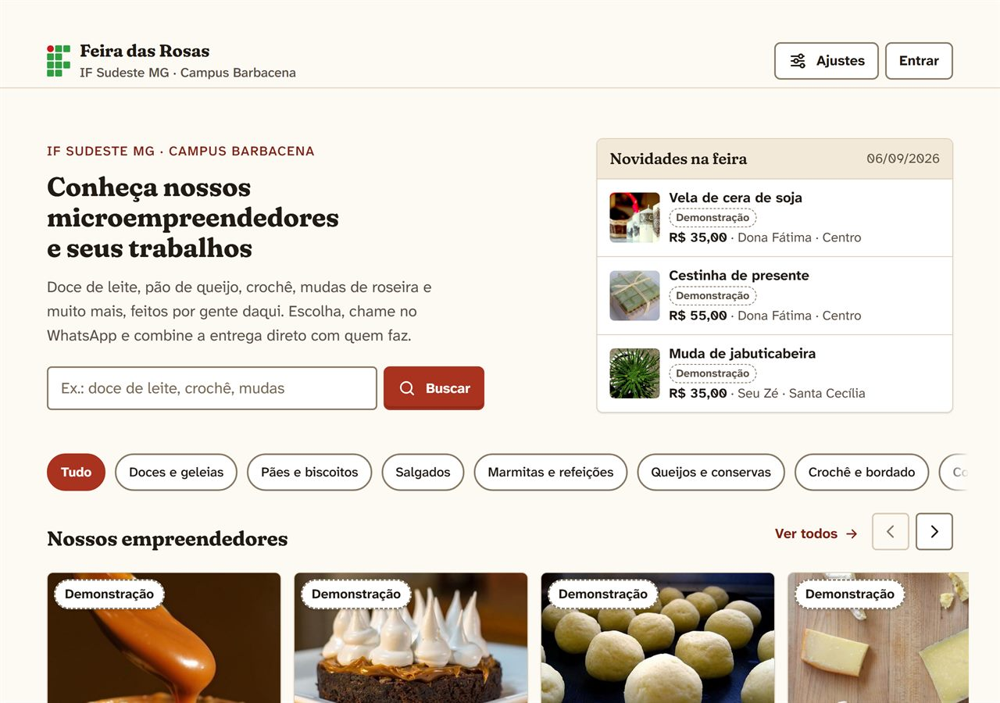
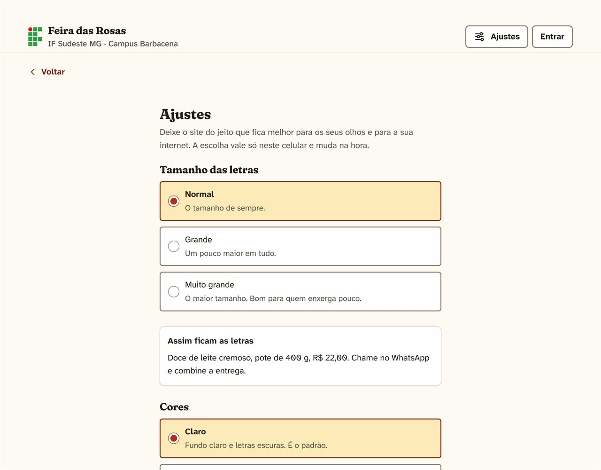
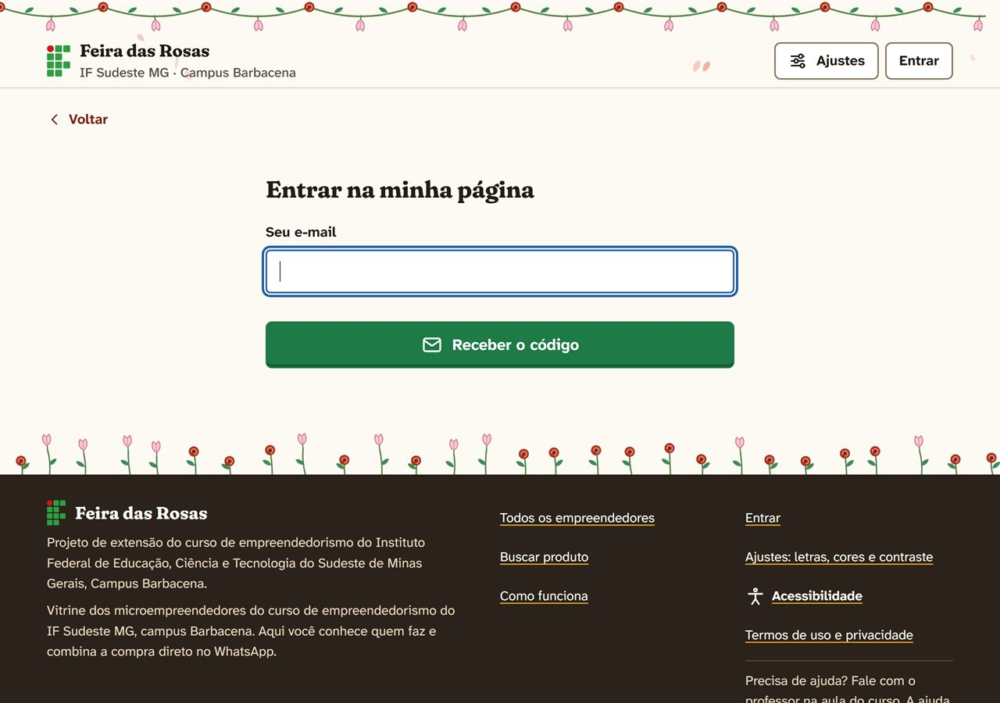

  <h1>🌹 Feira das Rosas</h1>

  

    <strong>Vitrine on-line dos microempreendedores do curso de empreendedorismo do IF Sudeste MG – Campus Barbacena.</strong>
  

  

    Cada pessoa ganha uma página com a sua história e o catálogo com preços; quem visita escolhe, toca em <strong>Chamar no WhatsApp</strong> e combina a compra direto com quem faz.
  

  

    
    
    
    
  

  <h3>🌐 <a href="https://if-empreendedores.cul4s.com">Visitar a Feira das Rosas</a></h3>
  O site abre só para acessos do Brasil.

  

## Sobre

A **Feira das Rosas** é um projeto de extensão do curso de empreendedorismo do IF Sudeste MG – Campus Barbacena. Doce de leite, pão de queijo, crochê, mudas de roseira e muito mais, feitos por gente da região, reunidos numa vitrine que qualquer pessoa abre no celular.

O site **não vende**: ele mostra quem faz, o que faz e por quanto, e liga o visitante direto ao WhatsApp da pessoa. Sem carrinho e sem intermediário.

Foi pensado desde o começo para quem tem pouca intimidade com tecnologia, celular simples e internet limitada. O projeto tem até um roteiro de teste em aula: as próprias vendedoras usam o site sozinhas, e o que fizer mais de uma pessoa travar vira correção.

> Este é um repositório público de apresentação. O código-fonte, o servidor e os dados das pessoas cadastradas ficam em um repositório privado.

## Funcionalidades

**Para quem visita**

- Busca, seções por categoria e "Veja também" com outras pessoas da mesma seção.
- Página de cada empreendedor com foto, história, formas de entrega, catálogo com preços e botão de WhatsApp fixo ao rolar.
- Ouvir a página em voz alta, com a voz em português do próprio aparelho.
- Libras opcional, pelo VLibras do gov.br.

**Para quem vende**

- Entrar só com o e-mail e um código de 6 números, sem senha para decorar; o aparelho fica lembrado.
- Painel com checklist "Sua página está quase pronta", cadastro de produtos e fotos (inclusive as do iPhone, convertidas no próprio celular antes de subir).
- Falar em vez de digitar nos campos do painel, e uma sugestão de texto para a descrição dos produtos, ainda em desenvolvimento.
- **Números da minha página:** visitas por período, por produto e de onde vieram (QR do cartaz, link, Google, redes sociais), sem rastrear ninguém e sem cookie.
- Cartaz para imprimir com QR code da página e tabela de preços para imprimir ou mandar no WhatsApp.

**Para a equipe do curso**

- Área *Gerenciar* com papéis: administrador, coworker (professores) e vendedor.
- Cadastro de vendedoras só pelo e-mail, link de acesso para quem não usa e-mail e opção de abrir o painel da pessoa para ajudar durante a aula.
- Autorização de uso de dados (LGPD) antes do primeiro acesso, registrada com data e versão dos termos.

## Acessibilidade e Internet Limitada

- Letras até 125%, tema claro, escuro ou igual ao celular, alto contraste e espaçamento maior entre letras e linhas.
- Respeito ao "reduzir movimento" do aparelho, com opção de desligar as animações.
- Modo leve: as fotos só carregam ao tocar, e o modo liga sozinho quando o celular está economizando dados.
- Rascunho automático dos formulários, para ninguém perder o que digitou se a internet cair.
- Declaração de acessibilidade no site, com base no eMAG, na LBI (Lei 13.146/2015) e nas diretrizes WCAG 2.2.

  

## Operação e Segurança

- **Publicação automática:** cada alteração passa por testes de fluxo no Chrome antes de ir ao ar; se o site não responder depois da troca, a versão anterior volta sozinha.
- **Monitoramento:** o site é conferido de hora em hora, com aviso por e-mail se cair.
- **Cópia de segurança:** banco e fotos copiados todo dia e enviados criptografados para a nuvem.
- **Privacidade:** contagem de visitas sem cookie e sem guardar quem visitou; o site atende só acessos do Brasil.

  

## Tecnologias

- **HTML, CSS e JavaScript puro** no site, sem framework, com service worker para cada publicação chegar na hora.
- **WebGL 2** nas pétalas animadas da capa e **Web Speech API** para ouvir e ditar.
- **Node.js 22**, **Express 5** e **SQLite** embutido do Node no servidor.
- **sharp** para as fotos e **nodemailer** para os códigos de acesso por e-mail.
- **GitHub Actions** para testes, publicação e monitoramento, numa VPS própria.

## Repositório

Este repositório existe para apresentar o projeto de forma pública. Ele não contém:

- código-fonte do site e do servidor;
- dados, fotos ou contatos das pessoas cadastradas;
- configurações do servidor, chaves ou credenciais.

As imagens acima são do **modo de demonstração**, com pessoas fictícias e fotos ilustrativas do Flickr (Creative Commons).

## Autor

**Lucas Martin**  
[GitHub](https://github.com/cuLasss) · [LinkedIn](https://www.linkedin.com/in/lucas-m4rtin/)

---

  Feito em Barbacena, Minas Gerais, para quem faz e vende aqui.

